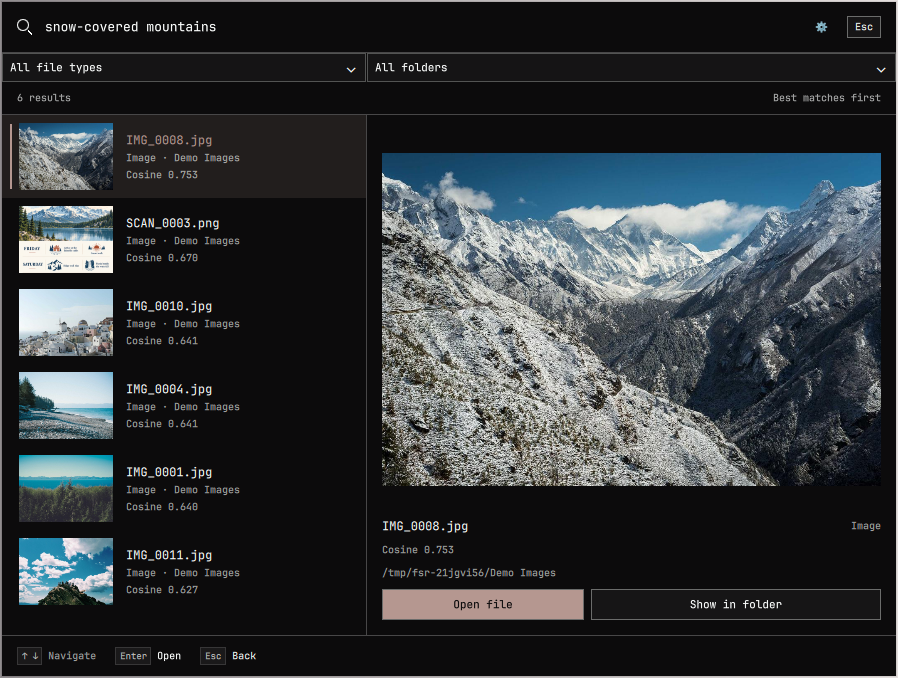
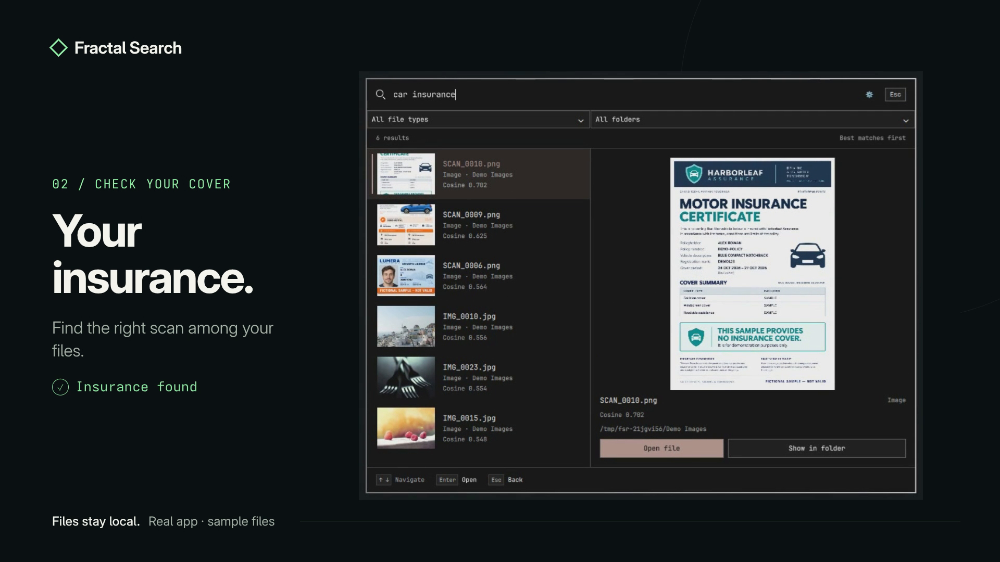

# Fractal Search

Local semantic search for images, text, audio and video on Omarchy Shell.

Add your folders, search in natural language, and open a match in its default app. Your files stay where they are; indexing and search run on your machine.





## Features

- **Search by meaning:** find images and media without knowing their filenames. Text search combines semantic matches with keyword search.
- **Preview your results:** view images, read text excerpts, and play audio/video from the matched timestamp.
- **Fit your desktop:** Omarchy themes, keyboard navigation, folder/type filters and a choice of list or split preview layouts.
- **Keep your library current:** optional folder watching, incremental rescans and visible indexing issues.
- **Choose your hardware:** CPU support, with optional NVIDIA CUDA acceleration.
- **Connect an agent:** copy client configuration from Settings → Preferences. A separate read-only MCP server provides catalog search, excerpts and cached thumbnails without exposing original paths or file bytes.

## Supported files

| Type | Support |
| --- | --- |
| Images | JPEG, PNG, WebP, GIF, BMP, TIFF, HEIC and HEIF |
| Text | UTF-8 `.txt`, `.md` and `.markdown`, up to 2 MiB per file |
| Audio | FFmpeg-supported audio, searched in segments |
| Video | Visual content and available soundtracks, searched in segments |

Audio/video files are limited to 2 GiB and two hours. PDF, Office documents, OCR and transcription are not supported. See the [user guide](docs/USER-GUIDE.md#supported-media-and-result-segments) for decoding requirements and detailed limits.

## Get started

The prebuilt bundles target **up-to-date x86_64 Omarchy with Omarchy Shell**. Runtime dependencies are system packages; no custom build tools are needed. **Use the app’s bundle installer:** Omarchy’s generic git-plugin installer does not install the native backend.

Download **[v0.1.0](https://github.com/nigh8w0lf/fractal-search/releases/tag/v0.1.0)**:

| Linux x86_64 | Download |
| --- | --- |
| CPU | [CPU bundle](https://github.com/nigh8w0lf/fractal-search/releases/download/v0.1.0/fractal-search-0.1.0-linux-x86_64-cpu.tar.gz) |
| NVIDIA CUDA | [CUDA bundle](https://github.com/nigh8w0lf/fractal-search/releases/download/v0.1.0/fractal-search-0.1.0-linux-x86_64-cuda.tar.gz) |
| Verification | [SHA256SUMS](https://github.com/nigh8w0lf/fractal-search/releases/download/v0.1.0/SHA256SUMS) |

Verify the downloaded archive against its release checksum, extract it, then run inside the extracted directory:

```bash
sha256sum --check SHA256SUMS
./install.sh
omarchy-shell shell toggle fractal.search
```

Prebuilt installations need no Rust compiler or Python. Check the release’s architecture and system-library requirements. For NVIDIA acceleration, use the CUDA bundle with `./install.sh --provider cuda --device-id 0` and follow the [CUDA setup guide](quickshell-app/CUDA.md).

Required system packages include FFmpeg, Qt Multimedia with its FFmpeg backend, libheif, libjpeg-turbo, GLib, curl, jq and a FileChooser portal. The installer reports missing dependencies. CUDA additionally needs separately installed **CUDA 12 and cuDNN 9** libraries; an NVIDIA driver alone is insufficient.

On first launch, select **Set up model** to download and verify about **1.50 GB** of model assets, or choose an existing verified cache. Add folders under **Settings → Folders**, let indexing finish, then type a description to search.

To build from source, follow the [development guide](docs/DEVELOPMENT.md#build-and-install-from-source). For agent-assisted installation or troubleshooting, use [AGENT-SETUP.md](docs/AGENT-SETUP.md); it is also included in release bundles.

## Updates and removal

Update by running the new bundle’s `install.sh`. To uninstall, run the installed runtime’s uninstaller before removing the plugin through Omarchy:

```bash
SEARCH_PLUGIN_DIR="${XDG_CONFIG_HOME:-$HOME/.config}/omarchy/plugins/fractal.search"
SEARCH_INSTALLED_RUNTIME=$(cat "$SEARCH_PLUGIN_DIR/.fractal-search-install")
"$SEARCH_INSTALLED_RUNTIME/uninstall.sh"
```

Uninstall preserves your catalog, models and runtime bundles. See the [user guide](docs/USER-GUIDE.md#removal-and-permissions) for details.

## Documentation

| I want to… | Guide |
| --- | --- |
| Use the app, update, uninstall or troubleshoot | [User guide](docs/USER-GUIDE.md) |
| Have an agent set it up | [Agent setup](docs/AGENT-SETUP.md) |
| Configure NVIDIA acceleration | [CUDA](quickshell-app/CUDA.md) |
| Connect an MCP client | [MCP setup and privacy](quickshell-app/MCP.md) |
| Build or modify the app | [Development](docs/DEVELOPMENT.md) · [Contributor instructions](AGENTS.md) |
| Prepare release bundles or a marketplace listing | [Release preparation](docs/RELEASING.md) |

[All documentation](docs/README.md) includes architecture, model contracts, indexing details and validation reports.

## Privacy and license

Model setup downloads pinned assets from Hugging Face over HTTPS and verifies their sizes and hashes. Indexing and search run locally. The desktop app reads the folders you select and opens originals through your desktop’s file associations. Agent clients connected through MCP can receive bounded cached excerpts and thumbnails; see the [MCP privacy boundary](quickshell-app/MCP.md) before connecting a client.

[MIT license](LICENSE) · Copyright 2026 nigh8w0lf (Ashwin Cheekati). Dependencies and models retain their own licenses; release bundles include third-party notices and covered source.
